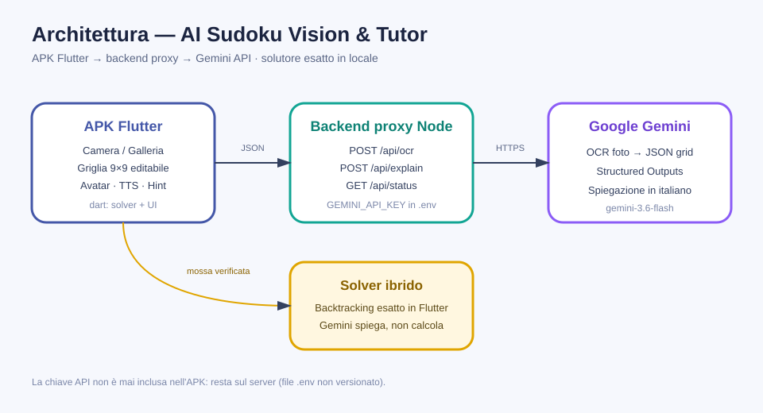
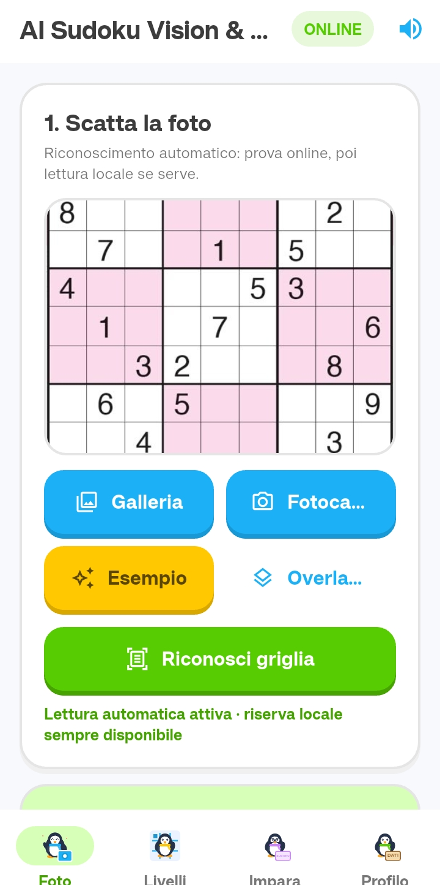
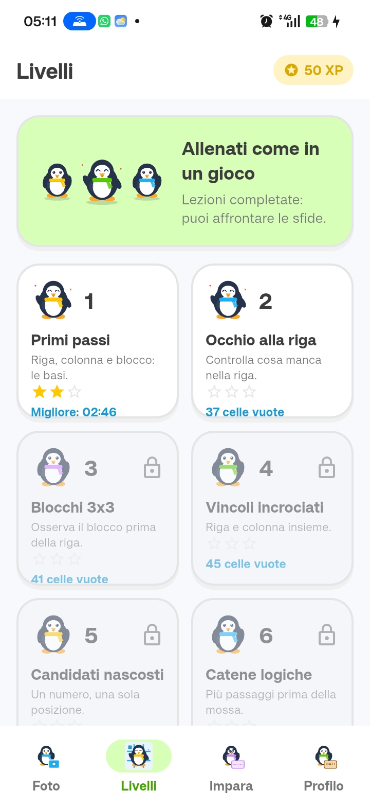
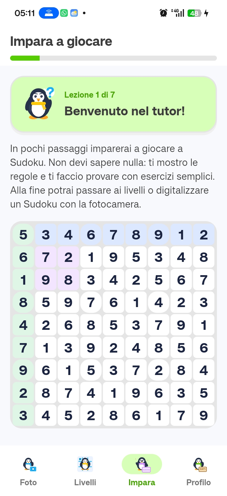
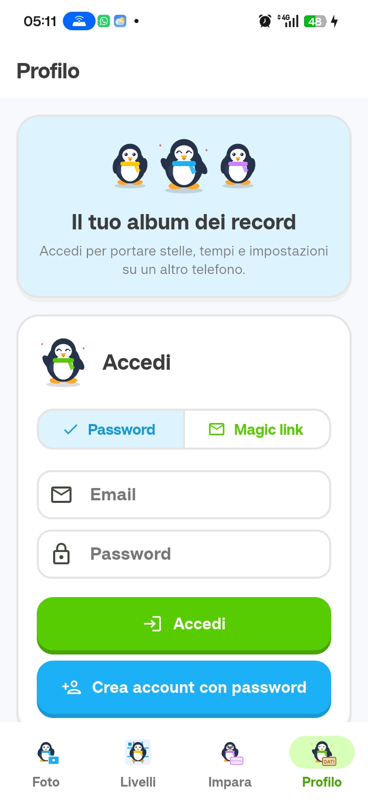

# AI Sudoku Vision & Tutor — Cat Edition — Relazione tecnica

**Versione stampabile (2 pagine A4):** [RELAZIONE.pdf](RELAZIONE.pdf) · **Repo:** [sudoku_ai](https://github.com/TUO-UTENTE/REPO-GATTO) · **APK:** [GitHub Release v1.0](https://github.com/TUO-UTENTE/REPO-GATTO/releases/latest)

Consegna: Google Classroom · SDK: Flutter + Android SDK · API: Google Gemini · Backend: Supabase Edge Function

## 1. Obiettivo

App Android installabile che fotografa un Sudoku cartaceo incompleto, digitalizza la matrice 9×9 tramite Gemini, consente la correzione manuale e offre un tutor logico in italiano (suggerimento spiegato, hint progressivi, risoluzione completa). Complementano l'esperienza 8 livelli didattici e 6 lezioni guidate, giocabili anche offline.

## 2. Architettura scelta

`Foto → Flutter → Supabase Edge Function (gemini-proxy) → Gemini API`.

La chiave Gemini (`GEMINI_API_KEY`) risiede **solo nei Supabase Secrets**: non è nell'APK e non è in `.env`. L'app invia la publishable key come header `apikey` / `Bearer`; URL e chiave sono iniettati a build time con `--dart-define`. Supabase fornisce anche Auth (magic link PKCE o email/password) e il sync dei progressi con Row Level Security. La `service_role` non è mai inclusa.

1. **Acquisizione** — `image_picker` da fotocamera o galleria, immagine in base64.
2. **OCR** — `POST /api/ocr` con Structured Outputs; validazione di una matrice 9×9 di interi 0–9. Se rete/funzione/chiave mancano, scatta l'OCR locale Tesseract (modello `eng` incluso, soglia di Otsu) validato dal solutore.
3. **Verifica** — griglia 9×9 editabile, cifre lette in blu, conflitti rossi, separatori neri tra i blocchi 3×3.
4. **Tutor** — `POST /api/explain` per la spiegazione in italiano; offline vengono usate regole locali.
5. **Risoluzione** — backtracking esatto con MRV in Dart e TypeScript: Gemini non calcola mai i numeri.
6. **Sync** — tabella `player_progress` con RLS per utente; nessuna UI di configurazione esposta all'utente.

*Figura 1 — Architettura e solver ibrido.*

## 3. Integrazione API e JSON

Modello primario `gemini-3.6-flash`, fallback `gemini-3.5-flash-lite` e `gemini-3.8-flash`. Schema OCR: `{ valid, grid: number[9][9], note }`; schema spiegazione: `{ row, col, valore, spiegazione }`. La Edge Function rimuove le fence Markdown, esegue `JSON.parse`, valida forma e valori e restituisce errori HTTP 400/422/502/503.

## 4. Funzionalità bonus implementate

| Bonus | Implementazione |
|---|---|
| Tutor vocale | `flutter_tts` in `it-IT`, pulsante “Leggi” |
| Avatar interattivo | Gatto `CustomPainter` con 4 stati; icone nav dedicate |
| Hint progressivi | Blocco → cella → numero spiegato; max 3 suggerimenti per partita |
| Solutore ibrido | Backtracking MRV in Dart/TypeScript, Gemini solo per spiegare |
| Overlay AR lite | Numeri mancanti sovrapposti alla foto |
| OCR offline | Tesseract4Android con modello `eng` incluso, senza rete né API key |
| Livelli e lezioni | 8 puzzle a soluzione unica, 3 cuori, errore immediato, cascade domino, XP/stelle; 6 lezioni interattive |
| UI e account | Tema Duolingo-style, linee nere 3×3, griglia della foto giocabile come i Livelli, login e cloud sync RLS |

## 5. Screenshot dell'app

| | | | |
|---|---|---|---|
|  Griglia / soluzione AI |  Percorso livelli |  Lezioni guidate |  Profilo e login |

Screenshot reali da dispositivo Android (720×1444 / 720×1570 px).

## 6. Test e risultati

- `flutter test`: **24 test superati** (solver, OCR, JSON, sync, navigazione, gameplay, griglia digitalizzata).
- `npm run test:server`: solver, conflitti, conteggio soluzioni e conversioni.
- `flutter build apk --release`: APK ~75,9 MB, Android 8+ (minSdk 24).

## Consegna

- [x] Codice sorgente completo (Flutter + Supabase Edge Function)
- [x] `.env.example` senza chiave reale
- [x] APK release nella [Release v1.0](https://github.com/TUO-UTENTE/REPO-GATTO/releases/latest)
- [x] Relazione tecnica in 2 pagine: [RELAZIONE.pdf](RELAZIONE.pdf)
- [x] Screenshot reali in `screenshots/`

Il PDF si rigenera con `python scripts/generate_relazione.py`.
